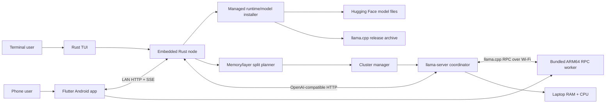
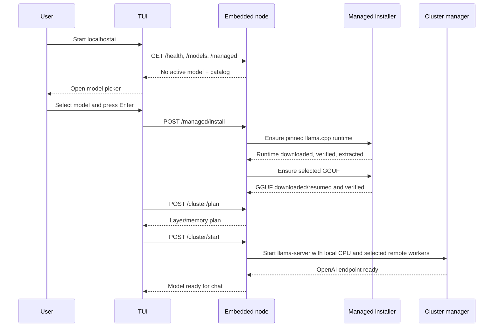
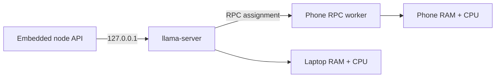
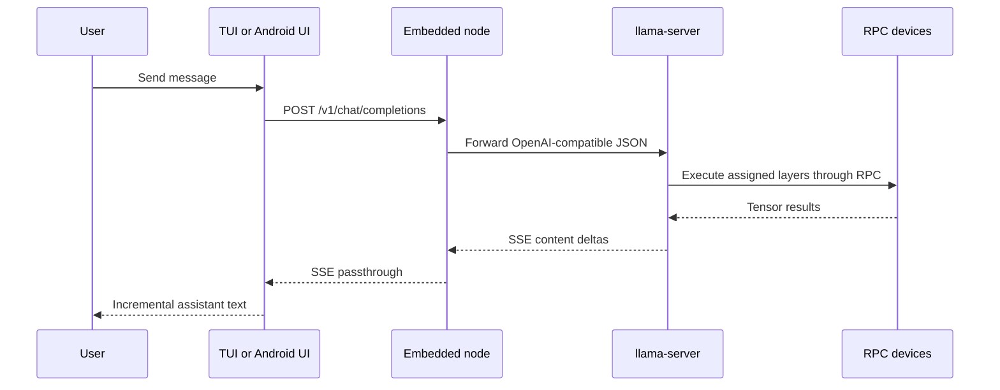

# localhost.ai Project Guide

This document describes the current localhost.ai implementation in detail. It is
intended for users, contributors, and maintainers who need to understand what
the project does, how its processes communicate, where data is stored, how
models are installed, and how laptop and phone resources are combined.

The implementation described here is the Rust embedded node and TUI plus the
Flutter Android application. The older Python and Termux implementations remain
in the repository for reference, but they are not part of the normal product
flow.

## Table of contents

1. [Purpose](#purpose)
2. [Design goals](#design-goals)
3. [System architecture](#system-architecture)
4. [Repository layout](#repository-layout)
5. [Laptop process model](#laptop-process-model)
6. [First-run and model installation flow](#first-run-and-model-installation-flow)
7. [Model catalog and storage](#model-catalog-and-storage)
8. [Terminal UI](#terminal-ui)
9. [Android application](#android-application)
10. [Pairing and discovery](#pairing-and-discovery)
11. [Resource sharing and statistics](#resource-sharing-and-statistics)
12. [Split planning](#split-planning)
13. [Cluster startup and distributed inference](#cluster-startup-and-distributed-inference)
14. [Chat request flow](#chat-request-flow)
15. [Embedded node API](#embedded-node-api)
16. [Configuration and files](#configuration-and-files)
17. [Networking](#networking)
18. [Security and privacy](#security-and-privacy)
19. [Build and run](#build-and-run)
20. [Testing](#testing)
21. [Troubleshooting](#troubleshooting)
22. [Current limitations](#current-limitations)
23. [Important invariants](#important-invariants)

## Purpose

localhost.ai runs a private language model on devices controlled by the user. The
laptop is the coordinator. It provides:

- An interactive terminal chat UI.
- A LAN HTTP node used by the Android app.
- Model and llama.cpp runtime installation.
- Device discovery and pairing.
- Model split planning.
- Lifecycle management for llama.cpp RPC and inference processes.

The Android app provides:

- A mobile chat UI.
- QR pairing with the laptop.
- A view of the compute pool and split plan.
- An optional ARM64 llama.cpp RPC worker that contributes phone RAM and CPU.

Ollama is not required. The default path is fully managed by localhost.ai: the TUI
downloads a pinned llama.cpp runtime, downloads a selected GGUF model, verifies
both, starts the processes, and routes chat through them.

## Design goals

The current design is built around the following rules:

- One laptop executable. The TUI and node run in the same process.
- One Android APK. The compute worker is bundled in the application.
- LAN communication only for laptop/phone operation.
- No account, telemetry service, or required cloud backend.
- No manually started Python service.
- No Termux requirement for the phone worker.
- No invented compute capacity. A remote device only contributes when its RPC
  worker is reachable.
- Explicit sharing consent. The phone switch and laptop TUI can independently
  refuse resource sharing.
- Managed processes stop with the owning application.
- Downloads are pinned, checksummed, resumable, and retried after transient
  connection failures.

## System architecture



The main architectural point is that the Rust executable is both client and
server. There is no separate laptop daemon to install. When the TUI starts a
local node, the node listener, discovery responder, model manager, planner, and
chat UI all belong to the same process.

## Repository layout

| Path | Purpose |
|---|---|
| `core/` | Rust library containing the embedded node and inference orchestration. |
| `core/src/config.rs` | Configuration, directories, token creation, and port selection. |
| `core/src/managed.rs` | Pinned runtime/model catalog, downloads, resume, retries, and checksums. |
| `core/src/model_hub.rs` | Hugging Face discovery, quantization/shard choices, and direct GGUF links. |
| `core/src/hardware.rs` | RAM, available memory, CPU, thread tier, and shared-budget probing. |
| `core/src/gguf.rs` | Bounded GGUF metadata inspection without loading tensor weights. |
| `core/src/rpc.rs` | Idle-worker RPC version and device-count preflight. |
| `core/src/plan.rs` | Layer and memory split planning. |
| `core/src/cluster.rs` | llama.cpp toolchain discovery and child-process lifecycle. |
| `core/src/server.rs` | Raw Tokio HTTP server, API routes, authentication, and proxying. |
| `core/src/api.rs` | Node client used by the TUI, including SSE parsing. |
| `core/src/discovery.rs` | UDP discovery responder and probe implementation. |
| `core/src/qr.rs` | Pairing URI and terminal QR generation. |
| `tui/` | The `localhostai` terminal executable. |
| `tui/src/main.rs` | CLI startup, TUI event loop, snapshots, and async actions. |
| `tui/src/app.rs` | TUI state and keyboard action mapping. |
| `tui/src/ui.rs` | Ratatui rendering for chat, models, devices, and pairing. |
| `app/` | Flutter Android client and bundled compute worker. |
| `app/lib/controllers/` | Chat state and backend selection. |
| `app/lib/services/` | Node client, discovery, storage, cloud backends, and worker lifecycle. |
| `app/lib/ui/` | Home, chat, pairing, settings, nodes, and compute-pool screens. |
| `app/android/` | Android manifest, Kotlin method channel, Gradle configuration, and native worker. |
| `laptop-node/` | Legacy Python node retained for reference and compatibility tests. |
| `phone-rpc/` | Legacy Termux setup retained for reference. |
| `scripts/` | Runtime checks and llama.cpp worker/build helpers. |
| `graphify-out/` | Generated project knowledge graph and architecture artifacts. |

## Laptop process model

Running `localhostai` without `--connect` performs the following startup work:

1. Parse CLI arguments before creating runtime state.
2. Load or create `~/.localhostai/config.toml`.
3. Create the model, binary, and log directories.
4. Load or atomically create the pairing token.
5. Bind the node to the preferred port or the next free port.
6. Start the HTTP accept loop as a Tokio task.
7. Start the UDP discovery responder when enabled.
8. Scan `~/.localhostai/models/` for installed GGUF files.
9. Probe the configured inference engine.
10. Start the interactive terminal UI.

The engine is re-probed every 15 seconds. This lets the node notice a managed
cluster transition or an optional external backend without restarting.

The TUI refreshes health, peers, cluster state, registered models, and managed
download state every four seconds. Network requests and model loading run in
background tasks so terminal input remains responsive.

On shutdown, the node broadcasts a stop signal, aborts open connection tasks,
and stops both llama.cpp child processes.

## First-run and model installation flow

On a fresh installation, no model is loaded. The TUI opens the model picker and
selects the recommended catalog model. The user can choose another model before
pressing Enter.



### Runtime installation

The managed runtime is pinned to llama.cpp `b12110`. Supported automatic
runtime downloads are:

- Linux x86_64
- Linux ARM64
- macOS x86_64
- macOS ARM64

The archive URL, byte count, and SHA-256 checksum are compiled into the Rust
binary. The archive is downloaded under `~/.localhostai/bin/`, checked, extracted
to a staging directory, validated for both required executables, then renamed
into place.

The two required executables are:

- `llama-server`
- `ggml-rpc-server`

Custom binaries can be selected with both `LOCALHOSTAI_LLAMA_SERVER` and
`LOCALHOSTAI_RPC_SERVER`.

### Model download behavior

Catalog URLs are pinned to immutable Hugging Face repository commits. A model
download is written to `<model>.gguf.part` and becomes visible as a normal GGUF
only after its expected size and SHA-256 checksum are correct.

Downloads support:

- HTTP range resume from the existing `.part` size.
- Automatic retry for timeouts, connection resets, truncated bodies, HTTP 408,
  HTTP 425, HTTP 429, and server errors.
- Up to eight attempts with exponential backoff.
- Reuse of a complete verified partial file after an interrupted finalization.
- Atomic rename from `.part` to `.gguf` after verification.
- Validation of the returned byte range before appending to a partial file.
- An installation lock so two node instances cannot write the same download.

Installed catalog files are checked by SHA-256 before first use in a node
process. Successful checks are cached with file size and modification time;
a changed file is checked again. A same-sized corrupt file is repaired by
selecting the model in the TUI rather than being passed to llama-server.

If localhost.ai is closed during a download, the `.part` file is retained. The
next selection of the same model continues from the saved byte offset.

## Model catalog and storage

The built-in catalog currently contains:

| ID | Display name | File size | Layers | License | Notes |
|---|---|---:|---:|---|---|
| `qwen2.5-0.5b-instruct-q4_k_m` | Qwen 2.5 0.5B Instruct | 491,400,032 bytes | 24 | Apache-2.0 | Fastest test model. |
| `qwen2.5-1.5b-instruct-q4_k_m` | Qwen 2.5 1.5B Instruct | 1,117,320,736 bytes | 28 | Apache-2.0 | Recommended default. |
| `qwen2.5-3b-instruct-q4_k_m` | Qwen 2.5 3B Instruct | 2,104,932,768 bytes | 36 | Qwen Research | Better quality and useful for a larger pool. |
| `qwen2.5-7b-instruct-q3_k_m` | Qwen 2.5 7B Instruct | 3,808,391,072 bytes | 28 | Apache-2.0 | General 7B option; Q3 reduces download and RAM pressure. |
| `qwen2.5-coder-7b-instruct-q4_k_m` | Qwen 2.5 Coder 7B Instruct | 4,683,073,536 bytes | 28 | Apache-2.0 | Higher-quality coding model for a larger pool. |

Models are stored in `~/.localhostai/models/`. They are downloaded only once.
Each later application start reloads the selected model into RAM but does not
download it again.

The general Qwen 7B Q4_K_M release is split into multiple GGUF shards. Starter
catalog entries each identify one checksummed file; the model browser also
supports complete split GGUFs. The starter catalog uses its official single-file Q3_K_M build and the
official single-file Coder Q4_K_M build. Both files are pinned to immutable
Hugging Face revisions. The planner still decides at load time whether current
free RAM can hold them; catalog presence is not a promise that a device fits.

localhost.ai also recognizes user-supplied `.gguf` files in the model directory.
It reads their GGUF v2/v3 architecture, transformer block count, and attention
dimensions. Tokenizer arrays and tensor weights are skipped during inspection.
Malformed or truncated metadata is rejected before engine startup. A caller's
explicit layer count must agree with the file; optional conservative KV
estimates may increase, but not understate, the derived cache estimate.

The TUI model picker combines three sets:

1. Models currently served by the active backend.
2. Installed GGUF files that can be planned and loaded.
3. Downloadable catalog entries.

Pressing Enter on an active model selects it. Pressing Enter on an installed or
downloadable GGUF installs it if necessary, plans it, and starts it. Pressing
`D` forces the distributed loading path.

## Terminal UI

### Main controls

| Key | Action |
|---|---|
| Text | Add text to the prompt. |
| `Enter` | Send a prompt when no overlay is open. |
| `Up` | Open the model picker. |
| `PageUp` / `PageDown` | Scroll conversation history; reaching the bottom resumes auto-follow. |
| `Left` / `Right`, `Home` / `End` | Move the prompt cursor. |
| `Delete`, `Backspace`, `Ctrl+W` | Edit at the cursor or delete the previous word. |
| `F1` | Open contextual keyboard help. |
| `Ctrl+A` | Open current/last operation details, download progress, assignments, errors, and log path. |
| `Ctrl+X` | Stop the current reply or unload/cancel a starting managed model. |
| `Ctrl+D` | Open resource controls and compute-pool statistics. |
| `Ctrl+P` | Open the pairing QR. |
| `Esc` | Close an overlay, or quit from the main screen. |
| `Ctrl+C` | Quit. |

### Model picker

The model picker shows whether a model is ready, installed, or downloadable.
For catalog models it also shows download size, license, recommendation state,
and a short description. `Left` and `Right` choose a 1,024, 2,048, 4,096,
8,192, or 16,384-token context. Each model/context selection requests an
authoritative placement preview from the node and displays fit/shortfall plus
per-device layers and estimated memory.

`Enter` loads a fitting model, `D` reloads it through the managed path, and `I`
downloads/verifies a catalog model without starting it. Catalog planning uses
pinned metadata and occurs before download. Installation then reads real GGUF
metadata and the node re-plans against current RAM, so a preview never bypasses
file integrity or final fit checks.

Bracketed paste is enabled; pasted line breaks become spaces instead of
accidentally submitting multiple prompts. Chat auto-follow pauses after PageUp
and does not jump while the user reads earlier output.

### Resource-control panel

Inside the `Ctrl+D` panel:

| Key | Action |
|---|---|
| `Up` / `Down` | Select a laptop or phone. |
| `Space` | Include or exclude the selected device from future split plans. |
| `Esc` | Close the panel. |

The panel shows:

- Total RAM.
- Currently available RAM.
- Safe shared-memory cap.
- Inference threads and logical cores.
- Worker reachability.
- Heartbeat age.
- RPC address.
- Planned active layers.
- Planned active memory allocation.

The allocation is the planner's assignment, not a live RSS measurement from
the operating system. Disabling a device does not interrupt an already running
model. It applies the next time a model is loaded.

Phone heartbeats update the phone's available-memory statistics without
overwriting the TUI inclusion choice. Inclusion choices are held for the node
session; restarting the laptop node resets them to enabled.

## Android application

The Android app is branded **localhost.ai — Run AI Locally**. It uses Flutter,
Riverpod for shared coordinator UI state, GoRouter for navigation, and the
existing GetX/Hive/HTTP backend services.

### Main screens

| Screen | Purpose |
|---|---|
| Onboarding | Three-page first-launch introduction to local chat and optional phone sharing. |
| Pair | Scan the coordinator QR or enter host, port, and token manually. |
| Chat | Stream replies from the selected backend. |
| Models | Search the pinned catalog; preview placement, download, verify, and load using existing APIs. |
| Server | Show coordinator status, copy its actual endpoint, load/stop models, pair, and share phone compute. |
| Compute pool | View devices, select an installed GGUF, plan, start, and stop a cluster. |
| Nodes | Discover or manually choose a laptop node. |
| Settings | Select laptop/cloud/local backend and configure keys or prompts. |

All screens implement `app/DESIGN_FLUTTER.md`: a black-only theme, green accent,
hairline dark cards, Outfit UI type, JetBrains Mono code/labels, terminal windows,
and the supplied localhost.ai logo. Tokens and themes live in `lib/theme/`,
shared widgets in `lib/widgets/`, and primary screens in `lib/features/`.
Fonts and licenses are bundled; runtime font fetching is disabled. Navigation
switches from a four-destination bottom bar to a rail at 840px. Body content is
width-capped at 720px for Chat and 1120px elsewhere. Status combines labels and
colors, and reduced motion disables pulse/typing effects.

Pairing exposes visible scan/manual modes, scanner lifecycle handling, field
validation, and obscured token entry. Chat lazily builds message bubbles, labels
speaker roles for accessibility, pauses auto-follow when the reader scrolls up,
and exposes an explicit stop-generation action. Coordinator requests run in
parallel and retain the last snapshot when the laptop becomes unreachable.
Server's terminal shows actual UI-observed connection/worker/model events and
the existing run-log path; it does not require an additional backend endpoint.
The app warns that coordinator HTTP and llama.cpp RPC traffic are unencrypted
and intended for a trusted LAN. Android backup and device-transfer backup are
disabled for pairing tokens, API keys, settings, and chat history.

### Local storage

Hive stores:

- Pairing payload and token.
- Last node URL.
- Stable random phone device ID.
- Active chat backend.
- Cloud settings.
- System prompt.
- Android chat history.

Changing to a different manual node clears credentials for the old paired
node. Chat requests are generation-guarded so clearing a chat or changing a
backend prevents a late response from repopulating stale state.

### Phone worker

The APK contains an ARM64, statically linked `ggml-rpc-server` named
`libggmlrpc.so`. Android extracts native libraries to an executable directory.
The Kotlin method channel exposes:

- The native library directory.
- The app-private, OS-evictable cache directory.
- The current LAN IPv4 address from Wi-Fi, Ethernet, or a hotspot interface;
  cellular and VPN interfaces are excluded.
- Foreground sharing protection, native process tracking, and a private log directory.

When the user enables **Share this phone**, the service:

1. Starts the connected-device foreground service with CPU/Wi-Fi locks, then
   finds the first free port in the private range 50052 through 50062.
2. Starts the bundled worker on `0.0.0.0:<selected-port>` using the CPU device
   and llama.cpp's local weight cache.
3. Waits until the worker accepts TCP connections.
4. Resolves the phone's LAN address.
5. Re-reads available RAM after worker startup, then reports the fresh hardware
   profile, RPC address, and unique worker-session ID to the laptop.
6. Sends a heartbeat every 10 seconds.
7. Refreshes memory statistics and the current LAN address on every heartbeat.

Heartbeats are serialized. Stopping sharing cancels a pending address lookup,
waits for any in-flight report, and then withdraws the endpoint. A late heartbeat
cannot re-register a worker after it has been stopped.
Reports carry increasing sequence numbers. The coordinator ignores older
sequences and retired sessions, including requests that arrive after a client
timeout. Restarting a worker on the same port is still a new session.

The last valid RPC address survives a temporary LAN-address lookup failure. If
memory probing fails, the app reports zero available RAM rather than promising a
fabricated 4 GiB. Cached weight tensors can shorten retries and reloads without
storing prompts or chat history; Android may evict these files as normal cache.

When sharing is disabled, the app stops heartbeats, reports the device without
an RPC address, terminates the child process, and waits for it to exit. Startup
and shutdown are epoch-guarded to prevent rapid toggle races from leaving an
orphan process or withdrawing a newer registration.

The foreground notification provides a stop action. Task removal also stops
sharing. `phone-rpc/worker-lifecycle.cpp` observes the owning app process and
exits within about a second after that process is gone. It intentionally does
not use `PR_SET_PDEATHSIG`: that signal follows the spawning thread, which a
Dart runtime may retire while the app process remains alive. The wrapper also
ignores SIGPIPE and disables native worker core dumps.

Unexpected exits wait briefly for final stdout/stderr, retain the exit code
and output in `files/worker-last-failure.json`, and report them to the
coordinator. The Server terminal shows the retained native output. A later
successful coordinator poll does not erase the failure.

The phone worker is not standalone on-device chat inference. It is a remote
layer host used by the laptop coordinator.

### Optional backends

The Android chat layer also contains:

- An OpenAI-compatible cloud backend.
- An Anthropic Messages backend.
- A local-inference interface with a clear stub implementation.

The default product path is the paired laptop node. True standalone local
phone inference is not implemented in this build.

## Pairing and discovery

### Pairing URI

The laptop encodes the following URI into a terminal QR:

```text
localhostai://pair?h=<host>&p=<port>&t=<token>&n=<node-name>
```

The payload carries everything required to connect:

- Laptop LAN address.
- HTTP port.
- Pairing token.
- Display name.

Reserved characters and IPv6 hosts are encoded safely. The QR uses the
maintained Rust `qrcode` crate with medium error correction and terminal
half-block rendering.

### Pairing token

The token is 16 random bytes represented as 32 hexadecimal characters. It is
read from `/dev/urandom`, created atomically, and restricted to mode `0600` on
Unix. Concurrent first launches converge on one complete token rather than
overwriting each other.

### Discovery

The discovery protocol is:

```text
Phone -> UDP 255.255.255.255:50897: LOCALHOSTAI_DISCOVER
Node  -> unicast UDP response: JSON advert
```

The advert contains node name, HTTP port, active backend, model names, pairing
requirement, and protocol version.

Because many access points block broadcast traffic, the Android app also reads
the active Wi-Fi/Ethernet IPv4 prefix, scans at most a `/22` on TCP 8765, then
tries 8766–8774 for a `/24`-sized neighborhood when necessary.
Discovery results are deduplicated by address and port. Manual node entry
remains available.

If the node selected another port, UDP discovery reports it exactly. QR/manual
pairing remain the reliable fallback for wider networks and arbitrary ports.

## Resource sharing and statistics

Resource sharing has two independent consent gates:

1. The Android **Share this phone** switch controls whether the phone worker
   exists and advertises an RPC address.
2. The TUI resource panel controls whether the coordinator includes the device
   in future plans.

Both must permit sharing before phone memory is used.

### Hardware profile

Each device reports:

- Stable device ID.
- Human-readable name.
- Device kind: phone, laptop, or desktop.
- Total RAM.
- Currently available RAM.
- Safe shared-memory budget.
- Logical CPU count.
- Inference thread count.
- Architecture.
- Optional RPC endpoint.

### Shared-memory budget

localhost.ai reserves memory for the OS and foreground applications:

| Device kind | Reserve |
|---|---:|
| Phone | 900 MiB |
| Laptop | 1,400 MiB |
| Desktop | 2,048 MiB |

The shared budget is:

```text
min(total_ram - reserve, available_ram - reserve)
```

Subtraction is saturating, so a low-memory or busy device reports zero rather
than a negative or optimistic value.

For a remote worker, split planning keeps another 256 MiB of that shared budget
unassigned. This is headroom for RPC serialization, native compute buffers, and
short-lived allocation peaks; it is not added to the model-capacity total.

### Thread tier

The inference thread recommendation is based on total RAM, then capped by the
logical CPU count:

| Total RAM (MiB) | Suggested threads |
|---|---:|
| 12,000 or more | 6 |
| 8,000 to less than 12,000 | 4 |
| 4,000 to less than 8,000 | 3 |
| Less than 4,000 | 2 |

At least one thread is retained when the reported logical CPU count is zero or
invalid.

### Reachability and heartbeat

Heartbeat age and worker reachability are separate facts:

- A stale heartbeat does not automatically remove a reachable worker.
- A fresh heartbeat without a reachable RPC worker contributes no memory.
- Duplicate RPC endpoints are counted only once.
- A TUI-disabled device remains visible but contributes no planning capacity.

Idle RPC workers must complete a bounded two-second HELLO and device-count
exchange. A TCP listener alone is insufficient: the worker must speak RPC
8.0.x and expose one device, matching the bundled CPU worker.

The native RPC server handles one client connection at a time. Repeated fresh
connections can fill its listen backlog while inference is healthy. For a
worker already assigned to an active run, the node uses the owning cluster
state instead of opening another probe connection. The API marks this as
`in_use`; an idle worker is preflighted again before a replacement run starts.
Concurrent idle probes share a short-lived result and are serialized per
endpoint. Startup takes exclusive access until its preflight and process
launch finish. Queued polls recheck ownership after waiting, so an old
"stopped" snapshot cannot send a new probe into an active worker's socket.

## Split planning

Custom model downloads are inspected before they become plannable. A split
GGUF is loaded through its first shard, requires a complete, matching shard set,
and contributes the sum of all shard file sizes to weight-memory estimates.
Other shards are not registered as independent models.

llama.cpp RPC places model layers on devices. localhost.ai plans at layer
granularity.

### Runtime memory estimate

For a catalog or registered model:

```text
kv_mb      = ceil(kv_bytes_per_token * context_tokens / 1 MiB)
runtime_mb = model_file_mb + kv_mb
```

The transformer count comes from GGUF metadata. Where attention dimensions are
available, the default f16 KV estimate is:

```text
bytes_per_token = layers * kv_heads * (key_length + value_length) * 2
```

For architectures without usable attention metadata, a conservative fallback
estimate is used. Weights are still divided approximately across layers, so
the plan is not an operating-system-enforced memory quota.

A replacement plan credits the previous run's estimated allocation, capped by
physical capacity, because that run is stopped before the new model loads.
That credit also requires the same worker session; a restarted worker cannot
claim buffers from an older process merely because its address is unchanged.
Current free memory and releasable allocation are shown separately; already
allocated memory must not make an otherwise valid reload fail its capacity check.

### Planning algorithm

The planner:

1. Starts with the laptop if it is enabled.
2. Adds enabled phone peers whose RPC workers are reachable.
3. Removes devices with zero safe budget.
4. Places as many whole layers as fit in the coordinator's safe budget.
5. Spills only the remaining layers to remote devices, largest budget first.
6. Leaves remote devices idle when the model fits on the coordinator alone.
7. Marks the plan over budget if not every layer can be assigned.

Coordinator-first placement minimizes Wi-Fi tensor transfer and avoids using a
phone merely to balance an already-local model. Device budgets remain estimates,
so their OS/app reserves are still required for native RPC overhead.

Every assignment records:

- Device ID and name.
- Device kind.
- Layer count.
- Estimated assigned memory.
- Device budget.
- RPC address for remote devices.
- Worker session when supplied by the phone.

The plan is returned before a cluster is started. If it does not fit, the API
returns the plan and a shortfall instead of starting a process that is expected
to fail.

## Cluster startup and distributed inference

The cluster manager owns one laptop child process: a loopback-only
`llama-server` that coordinates the model and exposes an OpenAI-compatible
endpoint. Laptop layers run directly on llama-server's CPU backend. RPC is used
only for remote phone workers.

The phone worker is owned by the Android application, not by the laptop.

### Process topology



RPC device order follows the remote planned assignments. llama.cpp counts an
extra output layer in `-ngl` and its split fractions. A mixed run therefore
uses the remote transformer count plus one, adjusts the last remote split
weight for that extra position, and explicitly keeps output weights on CPU.
This makes actual transformer placement match the plan. A local-only run uses
`-ngl 0`; a remote-only run uses `-ngl 999`.

The managed launch uses one inference slot, a 256-token batch, a 64-token
microbatch, no additional prompt-cache RAM, and disables automatic fitting that
could silently override the chosen split. Laptop-side input/sampling and
coordinator memory are still required even when its transformer allocation is zero.

The coordinator binds to loopback on the first free port at or above 8081.
Remote RPC addresses come from peer registrations.

### State machine

Cluster states are:

- `stopped`
- `starting`
- `running`
- `failed`

Startup records the complete assignment list before spawning processes. The
node can therefore report planned active layers while loading is in progress.

A generation counter cancels stale starts. Readiness waits do not hold the
cluster state lock, so status and stop requests remain responsive while a model
is loading. If the child exits unexpectedly, the state becomes failed and the
node clears its stale inference endpoint. RPC errors include the worker addresses.
An explicit worker withdrawal fails a run that has layers on that worker. During
startup, fatal RPC/allocation markers in the run log are detected on the next
readiness poll instead of waiting for the full deadline.

Ctrl+C, SIGTERM, and SIGHUP use the same shutdown path as exiting the TUI: stop
accepting requests, terminate the managed engine, and wait for it to exit. On
Linux, a parent-death signal also kills the engine if the node crashes or is
forcibly killed with SIGKILL. An interrupted `--once` or `--status` command
returns a nonzero exit code rather than claiming a completed result.

llama-server has up to 180 seconds to become healthy. Logs are written to
`~/.localhostai/logs/cluster-<pid>-<run>.log`. Each run has its own file so a second
node instance or a retry does not overwrite the evidence of an earlier failure.

## Chat request flow



The TUI client and Android laptop backend both send OpenAI-style messages. A
system message is inserted when configured. If a request does not include a
model, the node chooses `default_model` from configuration or the first model
advertised by the active backend.

The node forwards non-streaming JSON responses directly. Streaming responses
are passed through as Server-Sent Events. Both Rust and Dart clients handle:

- UTF-8 characters split across TCP chunks.
- CRLF and LF line endings.
- Multiline SSE `data:` fields.
- Final events without a trailing newline.
- `[DONE]` termination.
- Structured stream errors.

Transport or stream failures are surfaced as errors instead of being stored as
assistant text. A clean socket EOF also counts as an interrupted reply unless
the stream has emitted a finish reason or its normal terminal event.

Android chat history is persisted in Hive. The terminal conversation currently
lives in memory for the life of the TUI process.

## Embedded node API

The Rust node uses raw Tokio TCP rather than a web framework and speaks JSON
plus SSE. It is a native-client API: browser `Origin` requests are rejected,
and CORS headers are not emitted.

### Endpoint summary

| Method | Path | Purpose |
|---|---|---|
| GET | `/health` | Public node status, backend, and served models. |
| GET | `/v1/models` | OpenAI-compatible active model list. |
| POST | `/v1/chat/completions` | Streaming or non-streaming chat. |
| GET | `/pair` | Pairing payload and local hardware information. |
| POST | `/pair/verify` | Validate the bearer token. |
| GET | `/managed` | Starter catalog, custom library, runtime state, and install progress. |
| POST | `/managed/install` | Install, resume, or verify a starter/custom model and runtime. |
| POST | `/managed/download` | Download and register a selected Hugging Face or URL source. |
| GET | `/managed/jobs[/<id>]` | List or inspect bounded installation jobs. |
| POST | `/managed/cancel` | Cancel an installation while retaining valid partial data. |
| POST | `/managed/delete` | Delete a stopped managed model. |
| POST | `/managed/runtime/reset` | Remove the stopped managed runtime for a clean reinstall. |
| POST | `/models/browse` | Search repositories, list GGUF variants, or inspect a file link. |
| GET | `/models` | GGUF files registered for planning. |
| POST | `/models` | Register a local GGUF path and optional metadata. |
| GET | `/peers` | Device statistics, inclusion, reachability, heartbeat, and allocation. |
| POST | `/peers` | Register or heartbeat a device. |
| POST | `/peers/toggle` | Include or exclude a device from future plans. |
| GET | `/cluster` | Cluster state, toolchain, peers, logs, and assignments. |
| POST | `/cluster/plan` | Produce a split plan. |
| POST | `/cluster/start` | Plan and start a registered GGUF. |
| POST | `/cluster/stop` | Stop the active cluster. |
| OPTIONS | any path | Native-client capability response; browser origins are rejected. |

### Health

Example response:

```json
{
  "ok": true,
  "name": "studio-laptop",
  "backend": "distributed",
  "models": ["qwen2.5-3b-instruct-q4_k_m"],
  "pairing": true,
  "version": "0.2.3"
}
```

`ok` means an inference upstream is currently available. A node with no loaded
model can still be reachable while returning `ok: false`.

### Managed installation

```http
POST /managed/install
Content-Type: application/json

{"model":"qwen2.5-1.5b-instruct-q4_k_m"}
```

`GET /managed` exposes phases such as:

- `idle`
- `downloading_runtime`
- `installing_runtime`
- `verifying_model`
- `downloading_model`
- `ready`
- `failed`
- `cancelled`

`POST /managed/install`, `/managed/download`, and `/models/browse` always
require `Authorization: Bearer <pair_token>`, including when general chat is
configured without mandatory pairing. The embedded TUI supplies its local token
automatically.

TUI and Android clients create asynchronous jobs and poll `/managed/jobs/<id>`.
At most one job installs while two wait in the bounded queue. Cancellation and
the two-hour whole-job deadline retain verified partial data for a later retry.

### User-selected model downloads

The TUI model picker opens the model browser with **B**. Android exposes it
through **Models → Find and download models**. Search phrases return Hugging
Face repositories; `owner/repo` returns GGUF variants sorted by download size.
Hugging Face file/page links and other direct HTTP(S) GGUF links are accepted.

```http
POST /models/browse
Content-Type: application/json

{"query":"Qwen/Qwen2.5-0.5B-Instruct-GGUF"}
```

The response contains `repositories`, `models`, and optional `repository`.
Each model includes its source, byte size, published license, and file list.
An empty search returns popular GGUF repositories; search results show up to
40 repositories, and an exact repository can always be opened directly.

Pass the chosen model's `source` to the installer:

```http
POST /managed/download
Content-Type: application/json

{"source":{"kind":"hugging_face","repository":"Qwen/Qwen2.5-0.5B-Instruct-GGUF","filename":"qwen2.5-0.5b-instruct-q8_0.gguf","revision":"9217f5db79a29953eb74d5343926648285ec7e67"}}
```

Direct URLs use `{"source":{"kind":"url","url":"https://host/model.gguf"}}`,
with an optional 64-character `sha256` inside `source`. The coordinator resolves
metadata itself, serializes installation with the existing install lock, and
reports progress through `/managed`. It returns `{"ok":true,"model":...}` only
after the complete set has been downloaded and inspected. Installation does not
start inference; use `/cluster/plan` and `/cluster/start` with the returned name.

Hugging Face revisions are pinned to commits, published LFS checksums are
verified, and split GGUFs are grouped into one choice. Other URLs resume only
with an expected checksum or an HTTP validator (`If-Range`); unversioned sources
restart instead of combining bytes from potentially different files. Every
completed custom file receives a stored SHA-256 for validation on future loads.
Every outbound hop is DNS-resolved, pinned, and rejected when it targets a
loopback, private, link-local, documentation, benchmark, or metadata address.
Redirects are revalidated and HTTPS cannot downgrade to HTTP. Intentional LAN
model hosts require an explicit `allowed_model_hosts` config entry. Custom selections are capped at
128 GiB and 1,024 files; installation also requires the remaining download size
plus 512 MiB of free disk headroom. Model browse/download controls require the
pair token even when general chat pairing is disabled.
Persisted source records use private directory/file permissions, while the
public managed-library response omits source URLs and query parameters.

`/managed` includes a `custom` array alongside the starter `catalog`. Each entry
has `custom: true` and `installed`, including failed or partial downloads for
retry. `/managed/install` accepts these custom IDs for resume/verification.
Unknown layer counts are not guessed before download. Only complete, valid
sets are registered on restart. `HF_TOKEN` is read from the coordinator's
environment for repositories requiring access, and is never persisted in source
records or forwarded to unrelated file hosts.

### Peer registration

```json
{
  "id": "phone-<random-id>",
  "name": "this phone",
  "kind": "phone",
  "ram_mb": 8192,
  "available_mb": 4300,
  "cores": 8,
  "arch": "arm64",
  "rpc": "192.168.1.25:50052",
  "worker": {
    "session": "unique-sharing-session",
    "sequence": 1,
    "state": "running"
  }
}
```

Omitting `rpc` reports or withdraws hardware without claiming that the phone
can currently receive layers.
The optional `worker` object supports `running`, `stopped`, or `error`, plus
`exit_code`, `error`, and a bounded `log_tail`. A withdrawal omits `rpc` and
uses `stopped` or `error`. Legacy reports without this object remain supported.
Out-of-order reports return `{"ok":true,"ignored":true}` without modifying the
current device. Session/address changes fail an assigned run promptly, and
phone failure evidence arriving after a native abort is appended to that run.

### Resource toggle

```http
POST /peers/toggle
Content-Type: application/json

{"id":"phone-<random-id>","enabled":false}
```

Heartbeats replace hardware statistics but preserve this `enabled` value.

### Plan and start

```http
POST /cluster/plan
Content-Type: application/json

{"model":"qwen2.5-3b-instruct-q4_k_m","ctx":4096}
```

If the plan fits, the same request shape can be sent to `/cluster/start`.

### Chat

```http
POST /v1/chat/completions
Content-Type: application/json

{
  "model": "qwen2.5-3b-instruct-q4_k_m",
  "stream": true,
  "messages": [
    {"role": "user", "content": "Explain the split in one paragraph."}
  ]
}
```

### HTTP limits

The raw server currently enforces:

- Maximum HTTP headers: 64 KiB.
- Maximum request body: 4 MiB.
- Header/body read timeout: 15 seconds.
- `Content-Length` request bodies only.
- Chunked request transfer encoding is rejected.
- At most 64 accepted connections and 16 MiB of aggregate request buffering.
- At most two active/queued inference requests; excess requests receive 429.
- Response writes have a ten-second client deadline.

These limits apply to API requests, not model downloads. Downloads are made by
the node's outbound HTTP client.

## Configuration and files

### Runtime directory

The default home is `~/.localhostai`. Set `LOCALHOSTAI_HOME` to isolate a test or
use another location.

```text
~/.localhostai/
  config.toml
  pair_token
  models/
    *.gguf
    *.gguf.part
    custom/
      custom-<source-id>/
        source.json
        *.gguf
        *.gguf.part
  bin/
    llama-b12110/
  logs/
    cluster-<pid>-<run>.log
  install.lock
```

`history.db` has a reserved path in the Rust core but terminal history is not
currently written there.

### Default configuration

```toml
node_name = "<hostname>"
port = 8765
lan_enabled = true
discovery = true
engine = "managed"
ctx = 4096
require_pairing = true
allowed_model_hosts = []
```

| Setting | Meaning |
|---|---|
| `node_name` | Name advertised to phones and shown in UIs. |
| `port` | Preferred HTTP port; the node tries up to 100 ports from this value. |
| `lan_enabled` | Bind all interfaces when true, loopback only when false. |
| `discovery` | Enable UDP discovery responses. |
| `engine` | `managed`, `auto`, `ollama`, or `llamacpp`. |
| `allowed_model_hosts` | Explicit hostname/IP or `host:port` exceptions for trusted LAN GGUF sources. |
| `ollama_url` | Optional OpenAI-compatible Ollama base URL. |
| `llamacpp_url` | Optional external llama-server base URL. |
| `default_model` | Model used when a request omits one. |
| `ctx` | Managed/distributed context size. |
| `require_pairing` | Require bearer authentication for protected API routes. |

The TOML parser is strict. Invalid types, invalid URLs, unknown engine names,
and a zero context size fail with an actionable error instead of being silently
ignored.

### Environment variables

| Variable | Purpose |
|---|---|
| `LOCALHOSTAI_HOME` | Override `~/.localhostai`. |
| `LOCALHOSTAI_NODE_NAME` | Override the default hostname-based node name. |
| `LOCALHOSTAI_TOKEN` | Token used by `--connect` clients. |
| `LOCALHOSTAI_LLAMA_SERVER` | Explicit llama-server binary path. |
| `LOCALHOSTAI_RPC_SERVER` | Explicit ggml-rpc-server binary path. |
| `LOCALHOSTAI_DEBUG` | Print best-effort discovery errors. |

Both explicit toolchain variables must point to executable files.

## Networking

| Port/protocol | Owner | Purpose | Exposure |
|---|---|---|---|
| TCP 8765+ | Rust node | Health, pairing, chat, models, peers, cluster control | LAN or loopback based on config |
| UDP 50897 | Rust node | Discovery request/response | LAN |
| TCP 50052-50062 | Android worker | Phone model layers, with fallback around stale/orphan workers | LAN while sharing |
| TCP 8081+ | llama-server | OpenAI inference upstream | Loopback only |

The laptop and phone must be on a network that permits direct peer-to-peer TCP
traffic. Guest Wi-Fi, AP isolation, VPN routing, and host firewalls can block
discovery or RPC even when Internet access works.

The product does not use USB forwarding, ADB reverse, or Termux for normal
operation.

## Security and privacy

### Local inference

After the runtime and model have been downloaded, managed inference remains on
the laptop and enabled phone peers. Prompts are not sent to GitHub or Hugging
Face. Cloud traffic occurs only if the user selects and configures a cloud
backend.

### Download integrity

- Runtime archives are pinned by version, expected byte count, and SHA-256.
- Catalog model URLs are pinned to immutable repository commits.
- Model files are checked by expected byte count and SHA-256.
- Partial files are not registered as usable models.
- Extraction occurs only after runtime archive verification.

### API authentication

`GET /health` is public so discovery can verify a node. `/pair` returns the
secret only to loopback callers or already authenticated callers.
`/pair/verify` requires the token it verifies.

When `require_pairing` is true, all model, chat, peer, managed-runtime, and
cluster-control requests require:

```http
Authorization: Bearer <pair-token>
```

Token comparison is case-sensitive. Header and scheme names are treated
case-insensitively according to HTTP conventions.

### Network security boundary

The LAN API currently uses HTTP, not TLS. The bearer token protects application
authorization but is not encrypted in transit. Use localhost.ai on a trusted LAN
and enable pairing for multi-user networks.

### Resource consent

- The phone worker is off by default.
- The laptop can exclude any device from future plans.
- Disabled peers remain visible so the user can see their state.
- A peer without a reachable worker never contributes memory.
- Safe budgets reserve memory for the operating system and other applications.

## Build and run

### Build the Rust binary

```bash
cargo build --release
```

Result:

```text
target/release/localhostai
```

### Run interactively

```bash
./target/release/localhostai --require-pairing
```

The first-run picker performs runtime/model setup inside the TUI.

### CLI modes

```bash
./target/release/localhostai --status
./target/release/localhostai --headless
./target/release/localhostai --port 9000
./target/release/localhostai --name studio
./target/release/localhostai --no-lan
./target/release/localhostai --no-discovery
./target/release/localhostai --require-pairing
./target/release/localhostai --connect http://192.168.1.20:8765
```

`--status`, `--headless`, and `--once` are mutually exclusive.
`--headless` cannot be combined with `--connect`.

Standalone `--once` does not automatically load a stopped managed model. It is
most useful against an already active backend or with `--connect` to a running
node:

```bash
LOCALHOSTAI_TOKEN=<token> ./target/release/localhostai \
  --connect http://192.168.1.20:8765 --once "hello"
```

### Build the Android APK

Requirements include Flutter, Android SDK, Android NDK, and JDK 17.

```bash
cd app
flutter pub get
flutter analyze
flutter test
flutter build apk --release --target-platform android-arm64
```

Result:

```text
app/build/app/outputs/flutter-apk/app-release.apk
```

The release is ARM64-only because the bundled worker is ARM64. Release signing
uses ignored `android/key.properties` when present; otherwise development builds
fall back to debug signing.

### Rebuild the phone worker

```bash
bash scripts/build-phone-worker.sh
```

The script defaults to llama.cpp `b12110`, NDK 27, static ggml/C++ linkage, and
Android API 24. It accepts `LLAMA_CPP_REF`, `LLAMA_CPP_DIR`,
`ANDROID_NDK_ROOT`, `PHONE_WORKER_BUILD_DIR`, `CMAKE`, and `JOBS` overrides.
The wrapper source is `phone-rpc/`; the default build directory is
`target/phone-worker-b12110-guarded`.

## Testing

### Rust

```bash
cargo fmt --all --check
cargo clippy --workspace --all-targets -- -D warnings
cargo test --workspace --locked
```

The Rust tests cover configuration, concurrent token creation, discovery JSON,
QR generation, hardware budgets, split planning, process cancellation, API
authentication, large requests, SSE parsing, download resume/retry/checksum,
resource opt-out, heartbeat preservation, and TUI behavior.

### Flutter

```bash
cd app
flutter analyze --no-pub
flutter test --no-pub
```

The Flutter tests cover pairing payloads, device identities and budgets, worker
startup/shutdown races, chat cancellation, settings rebuilds, SSE parsing,
node authentication, pool parsing, model-picker refresh behavior, narrow-screen
and large-text reflow, semantic statuses/messages, and long device content.

### Runtime integration

```bash
python3 scripts/check-runtime.py
```

This check exercises CLI validation, remote status/once modes, authentication,
a real pseudo-terminal, first-run catalog rendering, resource controls, clean
terminal exit, and embedded paired chat against controlled local endpoints.

Optional arguments can validate real llama.cpp RPC device registration and an
already installed managed model.

`scripts/check-inference.py` performs real local and two-worker RPC inference
against an existing model. It verifies actual transformer placement in native
logs, repeated status polling, replacement loads, failure after a worker
disappears, and recovery using the remaining worker. Its worker processes run
on loopback; Android hardware still requires an on-device check.
It also runs 12-turn chat with varied prompt lengths while pool polling and
heartbeats overlap inference, including during startup and model replacement.

`python3 scripts/check-worker-lifecycle.py` compiles the phone entry point with
a small stand-in to test real Linux SIGPIPE and parent-process death behavior,
including the case where only the thread that spawned the worker exits.

### Legacy Python reference

```bash
cd laptop-node
python3 -m unittest -v test_server
```

These tests protect the retained reference node; they are not required to run
the Rust product.

## Troubleshooting

### `none - no model`

No inference endpoint is active. Press `Up`, choose an installed or catalog
model, and press Enter. localhost.ai installs missing components and starts the
model.

### Download interrupted or connection reset

localhost.ai keeps the `.part` file, retries transient failures automatically up
to eight times, and requests the remaining byte range. If the process was
closed, restart it, select the same model, and press Enter. Do not delete the
`.part` file unless intentionally restarting the download from zero.

### Phone appears but is not counted

Check all of the following:

- **Share this phone** is enabled in the Android app.
- The app remains open and the worker state is `running`.
- Laptop and phone are on the same peer-to-peer-capable Wi-Fi.
- The worker's displayed TCP port is reachable from the laptop.
- The device is checked `[x]` in the TUI `Ctrl+D` panel.
- Available RAM is greater than the phone safety reserve.

A fresh heartbeat without a reachable worker is intentionally not enough.

### Device is excluded

Open `Ctrl+D`, select the device with `Up` or `Down`, and press Space. The
change applies on the next model load. Reload the model from the model picker.

### Model does not fit

The returned plan lists placed layers and memory shortfall. Options are:

- Enable another reachable device.
- Free memory on the laptop or phone.
- Choose a smaller model.
- Lower context size in configuration.
- Re-enable a device excluded in the TUI.

### Cluster failed

Inspect:

```text
~/.localhostai/logs/cluster-<pid>-<run>.log
```

Common causes are an incompatible RPC worker, a missing/corrupt GGUF, port
conflicts, insufficient memory, or a worker disappearing during load.

If a run already completed replies before a socket failure, being on the same
LAN is not sufficient evidence that its worker stayed alive. Check the phone's
exit report and native output in Server and the coordinator run log. SIGKILL
is consistent with Android memory/background restrictions or a force-stop;
SIGABRT/SIGSEGV indicate a native abort/crash. The code alone cannot identify
an Android kill reason conclusively.

The coordinator monitors active runs every 500 ms and treats fatal RPC output
as failure even if llama-server has not exited yet. Failed sessions need
sharing restarted when necessary and the model reloaded; model buffers and KV
state cannot be transferred into a restarted worker by reconnecting its port.

### Discovery fails

Use QR pairing or manual node entry. Discovery can fail because of AP
isolation, broadcast filtering, a firewall, VPN routing, or a non-default node
port used with the subnet fallback.

### Pairing advertises a VPN address

The QR host is selected using the LAN broadcast route. Earlier builds used an
internet-route probe, which could select a Cloudflare WARP or other VPN address
instead of the laptop's Wi-Fi address. Nearby discovery could still work while
QR pairing and later requests failed against the different address.

After updating the coordinator, restart the laptop TUI, press Ctrl+P, and scan
the new code through **Server → Pairing** on the phone. Re-pairing replaces the
saved address; rebuilding the laptop binary alone cannot change an address
already stored on the phone. Confirm that the QR host matches the laptop's
LAN interface. The phone's sharing switch requires a saved pairing, even when
the coordinator allows unauthenticated chat connections.

An eight-second `TimeoutException` in the Flutter app comes from refreshing
`/managed` or `/models`; it does not by itself mean that the RPC worker failed.

### TUI reports no terminal

Interactive mode requires both stdin and stdout to be terminals. Use
`--status`, `--headless`, or `--connect ... --once ...` for scripts and remote
automation.

## Current limitations

- The managed Linux runtime is CPU-first. The distributed path currently uses
  CPU RPC devices; GPU-specific managed runtime selection is not implemented.
- The Android worker is ARM64-only.
- The foreground sharing service reduces suspension/background kills, but
  Android memory pressure, user force-stop, or network loss can still end a run.
- Device include/exclude choices persist in `~/.localhostai/devices.json`.
- Reported active allocation is the planner's estimate, not live process RSS.
- GGUF block counts are read from the file, but memory placement remains an
  estimate. Attention formats without derivable KV sizes use a fallback estimate.
- Android subnet fallback reads the active LAN prefix, caps scans at `/22`, and
  checks ports 8765–8774 when bounded fallback is needed. UDP/QR remain preferred.
- The LAN API is HTTP without TLS.
- The Rust TUI does not persist chat history yet.
- Standalone on-device phone inference is a stub; the bundled worker only hosts
  remote layers.
- Custom model installation accepts text GGUFs supported by the pinned runtime,
  not raw Transformers/safetensors weights. Split downloads are discovered as
  complete groups through Hugging Face. Other HTTP(S) file hosts must report
  their file size through Content-Length or Content-Range.
- Runtime replacement reinstalls the same pinned revision; selecting a newer
  llama.cpp revision remains an explicit release/build operation.
- The web project cannot perform UDP discovery or contribute a native worker.
- The Python node and Termux script are legacy references, not production
  dependencies.

## Important invariants

Maintainers should preserve these properties:

1. Preflight idle workers with the matching RPC protocol, not a TCP connect alone.
2. Keep heartbeat age separate from reachability.
3. Preserve coordinator inclusion choices across peer heartbeats.
4. Do not expose the pairing token to unauthenticated LAN callers.
5. Do not make a partial or checksum-failed download visible as an installed
   model.
6. Do not hold the cluster state lock while waiting for model readiness.
7. Keep laptop layers on the direct CPU backend; use RPC only for remote workers.
8. Keep laptop and APK RPC versions compatible.
9. Treat sharing as opt-in on the phone and reversible on the coordinator.
10. Distinguish total RAM, available RAM, safe shared cap, and planned
    allocation in every user-facing statistic.
11. Do not probe the single-client RPC socket of a worker already owned by a run.
12. Require a terminal stream event before treating a reply as completed.
13. Require the pair token for `/pair` and every control endpoint, including loopback.
14. Validate and pin every outbound model/runtime destination and redirect hop.
15. Count swap/zram and pressure as diagnostics only, never as model capacity.
