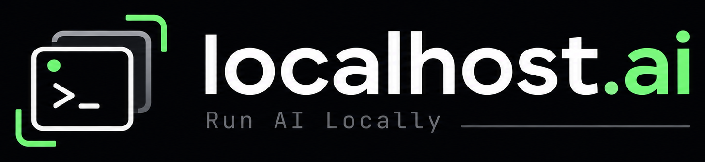
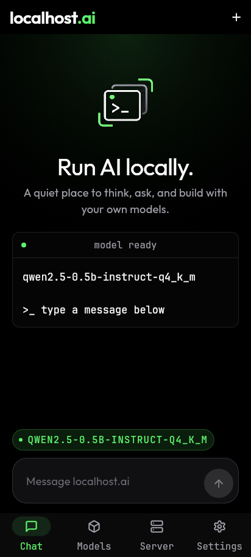
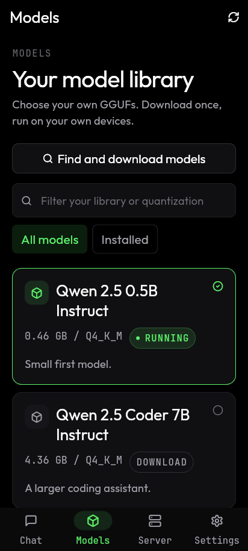
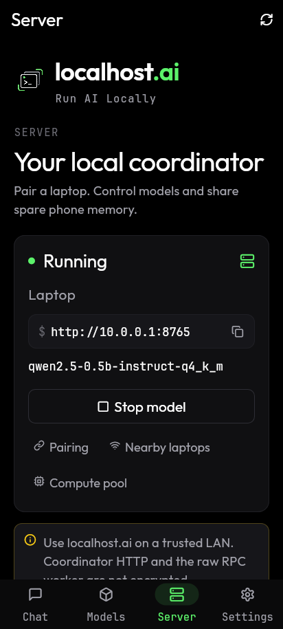
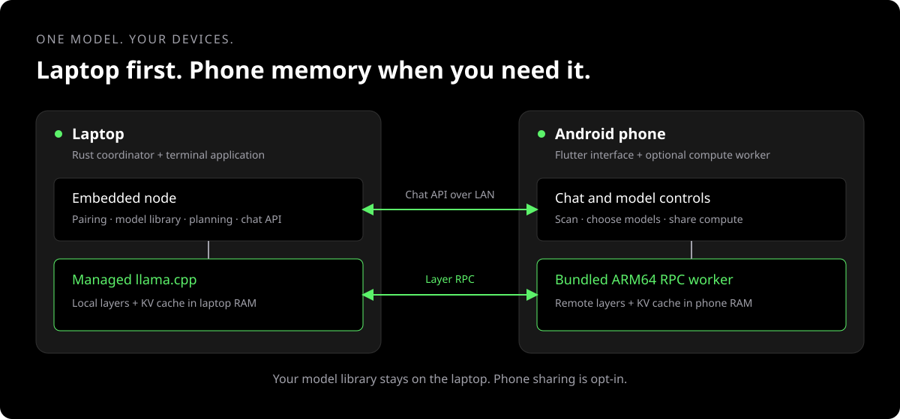

<p align="center">
  
</p>

<h1 align="center">Your laptop. Your phone. One private AI.</h1>

<p align="center">
  Run language models on your own hardware.<br>
  Start on your laptop, bring in your phone when you need more memory,<br>
  and choose the models you actually want to use.
</p>

<p align="center">
  <a href="https://github.com/Minhaj401/localhostai/actions/workflows/ci.yml"></a>
  <a href="https://github.com/Minhaj401/localhostai/releases"></a>
  <a href="LICENSE"></a>
  <a href="Cargo.toml"></a>
  <a href="app"></a>
</p>

<p align="center">
  <a href="https://local-host-ai.vercel.app"><strong>Website</strong></a> ·
  <a href="#see-it-in-action"><strong>Watch the demo</strong></a> ·
  <a href="#get-started"><strong>Get started</strong></a> ·
  <a href="https://github.com/Minhaj401/localhostai/releases/latest"><strong>Download</strong></a> ·
  <a href="PROJECT_GUIDE.md"><strong>Technical guide</strong></a>
</p>

---

**localhost.ai** combines a Rust terminal application, an embedded LAN coordinator, and a Flutter Android app into one local inference system. Your laptop runs the model; an optional worker inside the phone app can hold and compute the layers that need additional room.

**One laptop executable. One Android APK. Your choice of GGUF models.** No account or separate Ollama installation is required. The laptop executable is named `localhostai`.

## See it in action

A two-minute walkthrough: the memory-sharing architecture first, then pairing, model selection, phone sharing, placement, and chat.

https://github.com/user-attachments/assets/6f2a5b14-06e1-474b-8840-e677ec2a468c

<sub>1080p · English narration and captions · The interface walkthrough and allocation values are illustrative, not a live benchmark. The current app also includes the custom model browser shown below.</sub>

## Built around your devices

<table>
  <tr>
    <td width="50%" valign="top">
      <h3>Make room for a bigger model</h3>
      <p>Place model layers and their KV cache across laptop and phone memory. The planner keeps as much as possible on the laptop and uses remote workers for the remainder.</p>
    </td>
    <td width="50%" valign="top">
      <h3>Your models, your choice</h3>
      <p>Search Hugging Face, open a repository, or paste a GGUF link. Choose your quantization, download complete shard sets, and keep a persistent local model library.</p>
    </td>
  </tr>
  <tr>
    <td valign="top">
      <h3>One integrated workflow</h3>
      <p>The Rust TUI manages downloads, pairing, planning, and inference. The Android app handles mobile chat, model controls, and its bundled ARM64 compute worker.</p>
    </td>
    <td valign="top">
      <h3>Keep local chat local</h3>
      <p>Prompts stay on your devices and LAN in managed mode. No telemetry, account, or required cloud backend. External cloud providers are an explicit settings choice.</p>
    </td>
  </tr>
  <tr>
    <td valign="top">
      <h3>Know what will fit</h3>
      <p>See context size, layer placement, available RAM, and memory shortfall before loading. Only enabled, compatible, reachable workers contribute capacity.</p>
    </td>
    <td valign="top">
      <h3>Connect with your existing tools</h3>
      <p>An OpenAI-compatible chat API exposes streaming inference over the LAN. Use the terminal, phone, or a compatible client against the same coordinator.</p>
    </td>
  </tr>
</table>

## A focused interface

Black canvas, a single green accent, readable terminal controls, and an adaptive Flutter layout. Chat, model management, and server controls share one coordinator state.

<p align="center">
  
  &nbsp;
  
  &nbsp;
  
</p>

<p align="center"><sub>Chat · Models · Server<br>Actual application UI rendered with illustrative coordinator data.</sub></p>

## How the memory sharing works

<p align="center">
  
</p>

1. **Inspect the model.** Read GGUF transformer and attention metadata; count every shard and estimate weights plus context-dependent KV memory.
2. **Plan against available RAM.** Keep OS and application reserves, fill the laptop first, and place the remaining whole layers on opted-in workers.
3. **Load the selected placement.** localhost.ai starts its pinned llama.cpp runtime and connects to the phone's bundled RPC worker.
4. **Stream the answer.** The model executes across the selected devices; the coordinator returns incremental text to your client.

The benefit is **additional usable memory**. Wi-Fi, device CPUs, and the chosen split determine latency; adding a phone is not a promise of faster generation. Plans use physical RAM, not swap capacity, and remain estimates rather than enforced memory quotas.

## Get started

### 1. Start the laptop

Download the **Linux x86_64 terminal binary** from [Releases](https://github.com/Minhaj401/localhostai/releases/latest), or build from source on a supported platform:

```bash
git clone https://github.com/Minhaj401/localhostai.git
cd localhostai
cargo build --release --locked
./target/release/localhostai --require-pairing
```

Choose a starter model and press **Enter**. localhost.ai installs the pinned runtime, resumes and verifies the GGUF download, checks placement, and starts chat. Use **↑ → B** to browse other models.

<details>
<summary><strong>Use the prebuilt Linux binary</strong></summary>

```bash
curl -fL -o localhostai \
  https://github.com/Minhaj401/localhostai/releases/latest/download/localhostai-linux-x86_64
chmod +x localhostai
./localhostai --require-pairing
```

The prebuilt binary requires glibc 2.39+ and OpenSSL 3, as provided by Ubuntu 24.04 and compatible distributions. Release assets include SHA-256 checksums. For older Linux systems or other supported laptop platforms, build from source.

</details>

### 2. Pair the phone

Install **`localhostai-android-arm64.apk`** from [Releases](https://github.com/Minhaj401/localhostai/releases/latest). Connect both devices to the same LAN, press **Ctrl+P** on the laptop, and scan the QR through **Server → Pair laptop** in the app.

### 3. Choose how to run

- **Laptop only:** load a fitting model and chat from the terminal or phone.
- **Shared memory:** enable **Share this phone** in Server, then preview and reload the model. Inspect device participation with **Ctrl+D** on the laptop.
- **Bring your own model:** open **Models → Find and download models** on Android, or **↑ → B** in the TUI.

Phone sharing is opt-in on the phone and independently controllable from the laptop.

## Choose the model you need

The five starter Qwen models provide a convenient first run. **They are not a model allowlist.**

| Source | Workflow |
| --- | --- |
| Hugging Face search | Search a model name, open a repository, and choose a GGUF variant. |
| Exact repository | Enter `owner/repository` to browse its quantizations. |
| Direct GGUF link | Paste a file URL, including a Hugging Face `blob` or `resolve` link. |
| Existing local file | Place a GGUF in `~/.localhostai/models/` and restart, or register its path with the API. |
| Private or gated repository | Obtain access on Hugging Face and provide `HF_TOKEN` to the laptop coordinator. |

Hugging Face selections resolve to immutable revisions and use published checksums when available. Complete split GGUFs are grouped into one download. Interrupted downloads stay available for retry; installed custom models survive restarts and are checked before loading.

Downloads are stored on the laptop, under `~/.localhostai/models/`. Downloading a model and loading it are separate actions, so you can prepare your library ahead of time.

## Engineering beneath the interface

| Area | Implementation |
| --- | --- |
| Coordinator | Rust, Tokio, managed native processes, and an embedded HTTP API. |
| Terminal | Ratatui, streamed chat, model browser, context previews, QR pairing, and resource controls. |
| Android | Flutter, Riverpod connection state, GoRouter navigation, and a bundled ARM64 worker. |
| Inference | Pinned llama.cpp `b12110`, direct laptop CPU execution, and remote layer placement over RPC. |
| Downloads | Resumable transfers, range validation, checksums, atomic completion, and serialized installation. |
| Reliability | Worker sessions, ordered heartbeats, idle protocol checks, failure monitoring, and per-run logs. |

The coordinator avoids probing a worker's single-client RPC socket during an active run. Restarted workers invalidate old allocations, interrupted streams cannot become completed replies, and managed inference processes stop with their owner.

<details>
<summary><strong>Repository map</strong></summary>

```text
core/           Embedded Rust coordinator, model installer, planner, and API
tui/            localhostai terminal application
app/            Flutter Android app and bundled native worker
phone-rpc/      Native worker lifecycle wrapper and build configuration
scripts/        Runtime, inference, and worker verification tools
demo-video/     Editable source for the narrated project demo
docs/           Operations guide and README showcase assets
```

The retained `laptop-node/` Python prototype is a legacy reference. The normal product runs through the Rust coordinator.

</details>

## OpenAI-compatible API

Point compatible clients at `http://<laptop>:8765/v1`. With pairing enabled, use the token supplied by the coordinator.

```bash
curl http://localhost:8765/v1/chat/completions \
  -H "Authorization: Bearer $LOCALHOSTAI_TOKEN" \
  -H "Content-Type: application/json" \
  -d '{
    "model": "qwen2.5-1.5b-instruct-q4_k_m",
    "stream": true,
    "messages": [{"role": "user", "content": "Explain local AI in one sentence."}]
  }'
```

<details>
<summary><strong>CLI commands and terminal shortcuts</strong></summary>

| Command | Purpose |
| --- | --- |
| `localhostai` | Start the embedded node and interactive terminal. |
| `localhostai --require-pairing` | Require the pairing token for LAN chat and controls. |
| `localhostai --headless` | Run the coordinator without the TUI. |
| `localhostai --status` | Inspect the node and active backend. |
| `localhostai --connect http://HOST:PORT` | Attach to an existing coordinator. |
| `localhostai --connect http://HOST:PORT --once "Hello"` | Stream one reply from a loaded model. |
| `localhostai --no-lan` | Restrict the node to loopback. |

**Enter** send · **↑** models · **B** browse inside the picker · **←/→** context · **I** install only · **Ctrl+D** devices · **Ctrl+P** pair · **Ctrl+A** activity · **Ctrl+X** stop · **F1** help

Model browse, download, and resume endpoints always require the pairing token. See the [operations guide](docs/OPERATIONS.md) for configuration and the full endpoint list.

</details>

## Platform support and boundaries

| Platform | Current support |
| --- | --- |
| Linux x86_64 | Rust TUI/coordinator; prebuilt binary; automatic managed runtime. |
| Linux ARM64 | Source build; automatic managed runtime. |
| macOS Intel / Apple Silicon | Source build; managed runtime downloads. |
| Android ARM64, Android 7+ | Flutter app with bundled RPC worker. |

Use a **trusted LAN**: coordinator HTTP and raw RPC traffic are not encrypted. Model/runtime downloads contact their hosting services; managed prompts remain local. The phone hosts remote layers and still needs the laptop coordinator. GGUF architecture support depends on the pinned runtime; raw safetensors and standalone phone inference are not supported by this workflow.

The current distributed path uses CPU workers. Memory pressure, a force-stop, or network loss can interrupt a run; restore sharing and reload the model to recover. The TUI does not yet persist chat history. See [current limitations](PROJECT_GUIDE.md#current-limitations) for the complete picture.

## Verification you can reproduce

The current local verification pass covers **125 Rust tests** and **71 Flutter tests**, strict static checks, release builds, cold runtime installation through GitHub redirects, real CPU/RPC verification, and custom-download interruption/resume/restart checks. Native RPC integration uses loopback workers as phone stand-ins; it is separate from physical Android testing.

```bash
# From the repository root
cargo fmt --all -- --check
cargo test --workspace --locked
cargo clippy --workspace --all-targets --locked -- -D warnings
cargo build --workspace --locked
python3 scripts/check-runtime.py
```

```bash
# From app/
flutter pub get
flutter analyze
flutter test
flutter build apk --release --target-platform android-arm64
```

The [GitHub Actions workflow](.github/workflows/ci.yml) runs Rust and Flutter checks on pushes and pull requests. For native inference, placement, reloads, worker-loss recovery, and cleanup, use [`scripts/check-inference.py`](scripts/check-inference.py) with an existing GGUF and matching runtime. Android release builds use JDK 17; see [app build instructions](app/README.md#build-and-check).

## Explore, contribute, build

- **[Technical guide](PROJECT_GUIDE.md):** architecture, protocols, API, planning, and troubleshooting.
- **[Operations guide](docs/OPERATIONS.md):** commands, configuration, models, and distributed mode.
- **[Android development](app/README.md):** build, signing, assets, and worker setup.
- **[Contributing](CONTRIBUTING.md):** development checks and useful ways to help.
- **[Issues](https://github.com/Minhaj401/localhostai/issues):** report a reproducible problem or suggest an improvement.

## Acknowledgments

Built on [llama.cpp](https://github.com/ggml-org/llama.cpp), [Flutter](https://flutter.dev), [Tokio](https://tokio.rs), and [Ratatui](https://ratatui.rs). Starter model weights come from [Qwen](https://huggingface.co/Qwen); their licenses are published with each catalog entry. The demo was built with [HyperFrames](https://hyperframes.heygen.com). Outfit and JetBrains Mono font licenses ship with the app.

Project source is licensed under [MIT](LICENSE). Downloaded models and bundled third-party components retain their respective licenses.

---

<p align="center">
  <strong>Run AI locally. Make more of the hardware you already own.</strong><br>
  Built by <a href="https://github.com/Minhaj401">Minhaj Noushad</a>.
</p>
